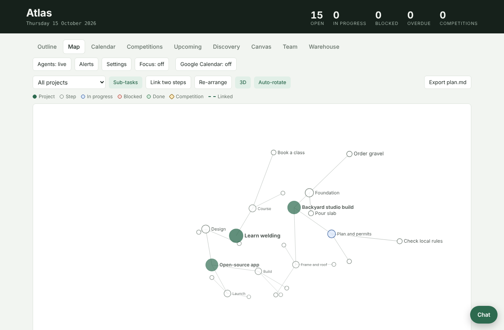
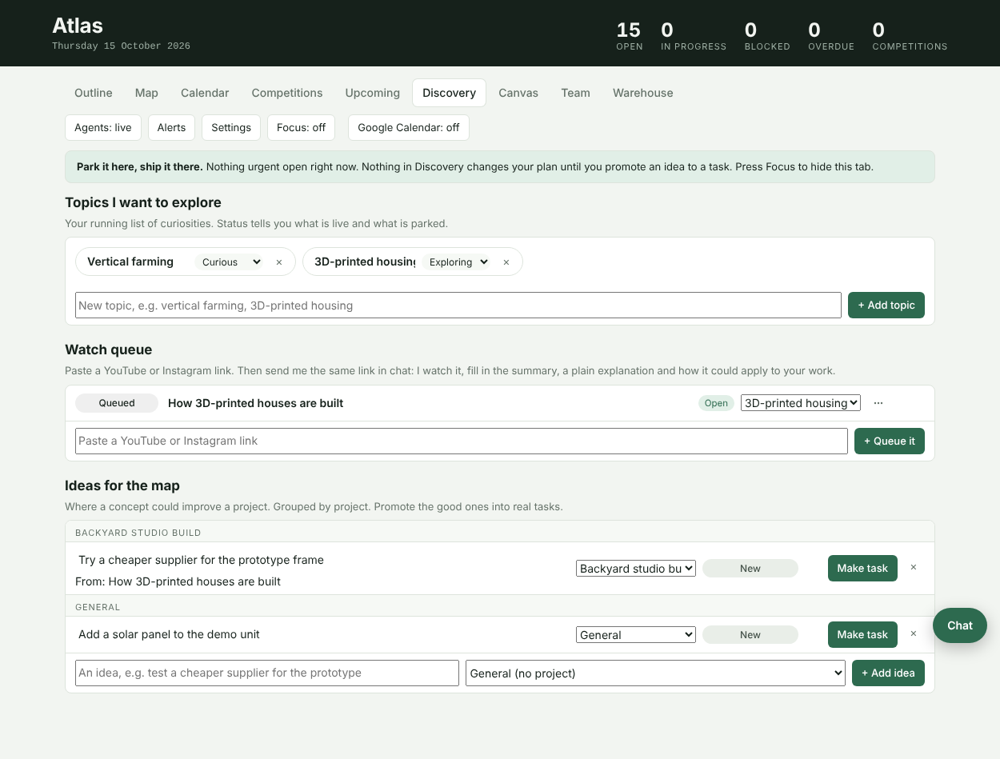

# Atlas

A private project tracker that runs entirely on your own Google account: Outline (Project > Task > Sub-task), a 2D/3D map of linked steps, Calendar, Competitions, Upcoming, a Discovery tab for things you want to learn, a free-form Canvas with arrows, a Team tab for AI agents, and a Warehouse for assets and suppliers.

> **Vibe coded.** This was built with an AI coding assistant (Claude) by someone who is not a professional software engineer. It has been tested only with a mocked Google backend, not yet on real Google. Expect rough edges and read the code before you trust it with anything important. No warranty (see LICENSE).

## What it is, and what it is not
- Your data lives in a Google Sheet ("Atlas Data") in your Drive. Deadlines can sync to a calendar called "Atlas". There is no server and no database run by anyone else.
- It is a Google Apps Script web app: two files (`Code.gs`, `Index.html`) you paste into your own Apps Script project.
- Not a multi-user product. Each person deploys their own copy.

## Install (about 5 minutes)
1. Sign in to the Google account you want to use. Go to <https://script.google.com> > New project. Name it "Atlas".
2. Paste `Code.gs` over the default file. At the top, set `TZ` to your timezone.
3. Click + next to Files > HTML. Name it exactly `Index`. Paste in `Index.html`.
4. Project Settings (gear) > tick "Show appsscript.json manifest file". Open it, paste in `appsscript.json`, set `timeZone` to yours.
5. Deploy > New deployment > Web app. Execute as: **Me**. Who has access: **Only myself**. Deploy.
6. Approve permissions. Google shows "unverified app" because it is your own script: Advanced > Go to Atlas.
7. Open the link, bookmark it. On a phone: Add to Home Screen.

## Optional links
- **Google Calendar:** the header button creates a calendar "Atlas" and syncs due dates.
- **AI agents and chat:** Settings > paste an API key (Anthropic, OpenAI or xAI) and pick a primary AI. ChatGPT Plus / Claude Pro subscriptions do not work here, only API keys with credit. Costs are billed by the provider. A master pause switch stops all agents.
- **Daily agent runs:** Settings > Turn on daily runs.
- **Drive folders for the chat:** Settings > add specific folders (read-only).
- **Notes docs:** open a task > Notes doc (one Google Doc per project).
- **Warehouse > Mirror to Sheet** writes assets and suppliers to Sheets.

After editing the code: Deploy > Manage deployments > Edit > New version.

## Privacy
See [SECURITY.md](SECURITY.md). Short version: keys stay in your Script Properties, data stays in your Drive, the app is only reachable by you.

## Contributing
Issues and PRs welcome, but this is a personal side project and replies may be slow.

## License
MIT. See [LICENSE](LICENSE).
